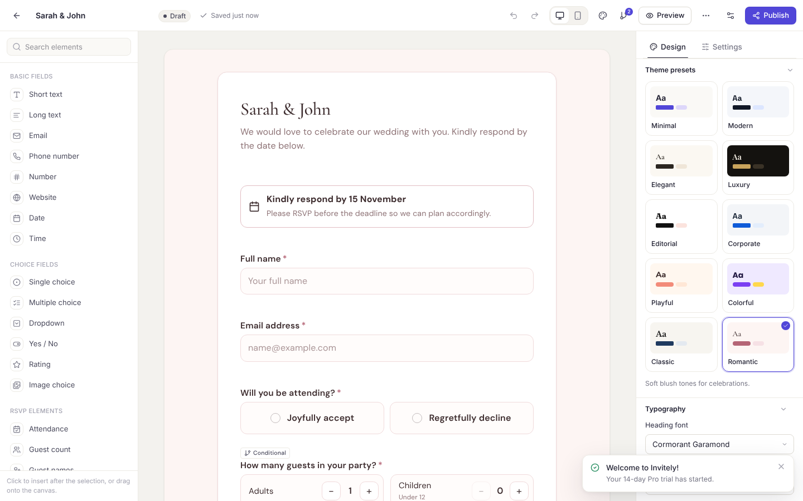
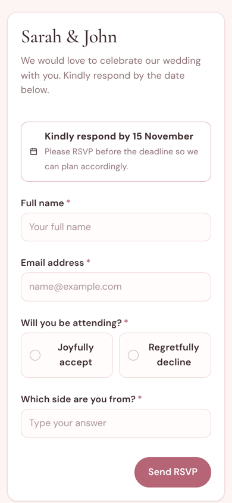
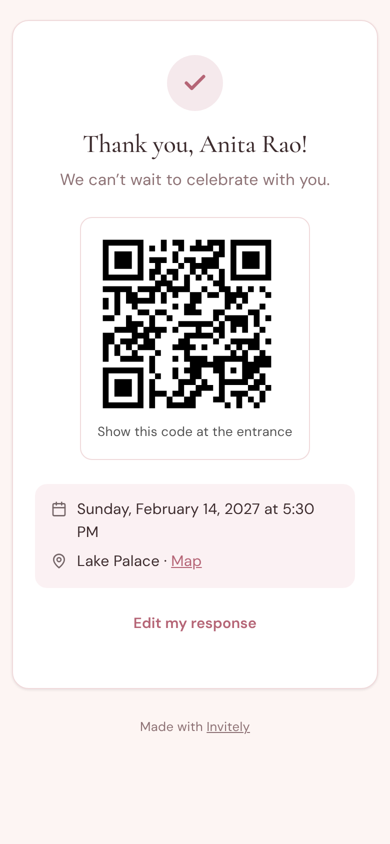
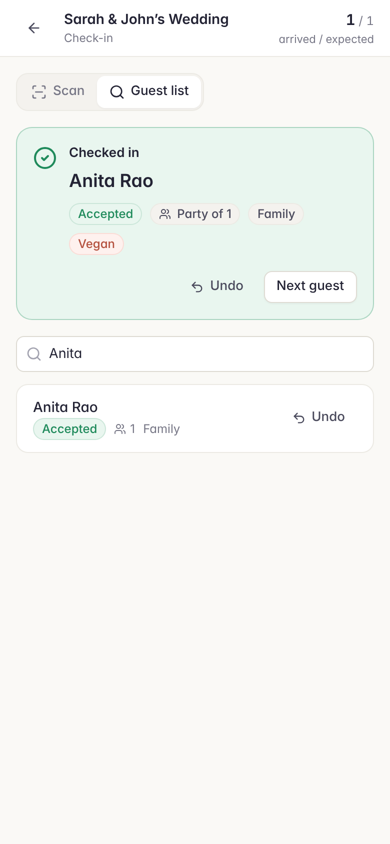

# Explainer — Building Invitely: a universal form & RSVP platform on Cloudflare

> **Who this is for.** Anyone reviewing PR “Universal Form & RSVP Creator”. The first half of *Background* is for readers new to the domain; skip to *The narrow background* if you already know form builders and Cloudflare Workers.

---

## Background

### The broad background

A form builder looks deceptively simple: a list of questions, a submit button, a table of answers. The difficulty hides in three places.

The first is that **a form is a program**. The moment you allow “if the guest declines, skip the meal question”, the form has control flow. That control flow must behave identically in three places: the editor’s preview, the respondent’s browser, and the server that stores the answers. If those three ever disagree, you get the most corrosive class of bug a data-collection product can have: answers that look valid on screen but are rejected, or worse, accepted when they should not be.

The second is that **forms change while people are answering them**. An organiser fixes a typo on Tuesday; a guest who opened the link on Monday submits on Wednesday. Which version did the guest answer? If the system simply overwrites the form definition, historical responses become uninterpretable: a column renamed from “Meal” to “Dinner choice” silently orphans every earlier answer.

The third is that **an RSVP product is not a form product with a different template**. A form ends at submission. An RSVP begins there: the response updates a guest’s status, feeds a headcount, triggers a confirmation email with an entry pass, and is later reconciled against who actually walked through the door. These are three different facts (invited, replied, attended), and conflating them is the usual source of wrong catering numbers.

### The narrow background

The repository was empty: no commits, no code (see `docs/00-audit.md`). The brief asked for a complete platform on Cloudflare: Workers for compute, D1 (SQLite) for relational data, R2 for files, Queues for background email, and the Cache API for hot reads. So the question was not “what can we reuse?” but “which decisions are expensive to change later, and how do we make them correctly up front?”

> **Key concept — the shared core.** `packages/core` is plain TypeScript with no React and no Workers APIs. It defines the form schema (Zod), the field registry, the logic engine, validation, themes, templates and plan definitions. The editor, the public renderer and the Worker all import it. It is the single answer to “what is a valid response?”

---

## Intuition

Take a concrete form with three fields:

```
attendance   (Accept / Decline)
guest_count  shown IF attendance = accept
meal         shown IF attendance = accept
```

A guest picks **Accept**, sets two guests, picks *Vegan*, then changes their mind and picks **Decline**. Their browser still holds `{attendance: "decline", guest_count: {adults: 2}, meal: "vegan"}`, because people don’t clear fields they can no longer see.

If the server stored that object verbatim, analytics would count two vegan meals for someone who isn’t coming. Instead, every layer runs the same `validateAnswers(schema, answers)`:

1. `evaluateLogic` decides `guest_count` and `meal` are **hidden** (their only `show` rule doesn’t match).
2. Hidden fields are neither validated nor kept, so `cleaned` becomes `{attendance: "decline"}`.
3. `deriveRsvp(cleaned)` yields `{status: "declined", partySize: 0}`.

The browser uses step 1 to hide the fields. The server uses all three to decide what to store. Because they share code, they cannot disagree.

The same idea, “compute it once and share it”, shapes the rest:

| Problem | Toy example | Mechanism |
|---|---|---|
| Edits vs. history | v1 has “Meal”, v2 renames it “Dinner choice” | Publishing **copies** the draft into an immutable `form_versions` row; each submission stores `form_version_id` and is always rendered against it. A SQLite trigger makes `UPDATE form_versions` fail. |
| Two tabs editing | Tab A saves revision 1→2; tab B still thinks it has revision 1 | Autosave sends `baseRevision`; the server updates only `WHERE draft_revision = ?`. Tab B gets **409** with the latest draft and chooses *Load theirs* or *Keep mine*. |
| Replied vs. attended | 148 accepted, 131 walked in | `event_guests.rsvp_status` and `checkins` are different tables; analytics labels “Expected attendees” and “Actual attendance” separately. |
| Plans | Free allows 3 forms | Limits are rows in `subscription_plans`; one module (`entitlements.ts`) answers every “may they?” question on the server. |

---

## Code

The change is large, so here is a walkthrough in dependency order.

### 1. `packages/core`: the contract

`schema.ts` defines the versioned document: `pages[] → elements[]`, `logic[]`, `settings`, `theme`. IDs are stable (`^[a-z][a-z0-9_]*$`) and never re-derived from labels.

```ts
export const elementSchema = z.object({
  id: idSchema, type: z.enum(FIELD_TYPES), label: z.string().max(500).default(''),
  required: z.boolean().optional(), config: elementConfigSchema.default({}), style: elementStyleSchema.optional(),
});
```

`fields.ts` is the registry: per type it lists the category, defaults, value kind, logic operators and **which inspector sections apply**, which is why the editor never shows a “Max length” box on a rating field.

`logic.ts` resolves visibility to a *fixed point*, so chained rules collapse correctly when an upstream field becomes hidden:

```ts
for (let iter = 0; iter < 8; iter++) {
  matched = schema.logic.filter((r) => ruleMatches(r, schema, answers, hidden, index));
  // …recompute hidden from show/hide actions; stop when stable
}
```

It also computes the **page path** (honouring `goto_page`, `skip_page` and empty pages). Fields on pages the respondent never visits are treated as hidden, so a guest who jumps past the travel page isn’t asked for an arrival date.

`validate.ts` validates every value kind and returns `cleaned` answers; `payment` values are always set by the server, never by the client.

### 2. `apps/api`: the Worker

Routing (`index.ts`) separates three trust zones:

```ts
v1.route('/public', publicApi);                    // anonymous, rate-limited
v1.route('/auth', auth);                           // CSRF header
ws.use('*', requireCsrfHeader, requireUser, requireWorkspace);
v1.route('/w/:wid', ws);                           // membership verified per request
```

The most important handler is `POST /public/forms/:slug/submissions` (`modules/public.ts`). In order, it: rate-limits per IP and per form, short-circuits on a repeated idempotency key, checks access (password token or invitation token bound to *this* form), applies the deadline and late policy, checks the monthly plan limit, runs `validateAnswers`, verifies uploads belong to this form, scores spam, detects duplicates, applies the RSVP (`services/rsvp.ts`, which also enforces event and session capacity), stores the submission plus normalised `answers` rows, and only then queues emails and webhooks.

Invitations are deliberately two-step:

```ts
// POST …/invitations/prepare → creates links, returns counts; sends nothing
// POST …/invitations/send requires the literal:
confirm: z.literal(true, { errorMap: () => ({ message: 'Confirm sending before emails are queued' }) }),
```

The queue consumer (`notifications.ts → processJob`) claims a job with a conditional `UPDATE`, delivers through Resend (or logs it in dev), retries with exponential backoff, and finally marks both the job and the invitation `failed`, where the UI offers *Retry*.

Database (`migrations/0001_init.sql`): 34 tables. The two constraints doing the most work are the immutability trigger and the partial unique index that makes duplicate check-ins impossible even under concurrent scanners:

```sql
CREATE UNIQUE INDEX checkins_unique ON checkins(event_guest_id, IFNULL(session_id, '')) WHERE undone_at IS NULL;
```

### 3. `packages/renderer`: one runtime, three modes

`FormRenderer` holds answers and errors in one hook and evaluates logic with `useMemo`. *Standard* renders the page path; *Multi-step* validates per page and navigates with `nextPageIndex`; *Conversational* flattens the path into single questions with keyboard shortcuts. Field components are `memo`ised, so typing in one field re-renders one field. Styling is plain CSS driven by theme tokens (`--f-primary`, `--f-radius`, …), with no Tailwind, which keeps the public bundle at about 97 KB gzipped.

### 4. `apps/web`: dashboard and editor

Two Vite entries: `index.html` for the dashboard and editor, and `public.html` for the public renderer. The build output confirms the public page loads no dashboard code.

The editor (`pages/editor`) has a Zustand store with structural operations and an undo history that **coalesces** rapid typing, so one word is one undo step:

```ts
const merge = coalesce && lastCoalesce?.key === coalesce && now - lastCoalesce.at < 1000;
```

`autosave.ts` debounces (900 ms), serialises requests, retries with backoff, flushes on tab hide, and warns before unload. The canvas renders the *real* renderer components in an inert “design” mode, swapping labels for an `InlineText` that inherits the theme typography, so what you edit is literally what guests see.



---

## Verification

| Suite | Result |
|---|---|
| Core unit tests | **27/27** |
| Renderer tests (jsdom) | **8/8** (every template × every layout renders) |
| API end-to-end against a live local Worker, D1, R2 and Queues | **29/29** |
| Browser journey (Playwright + Chromium, desktop + mobile) | **24/24 steps, 0 console errors, no horizontal overflow on 9 mobile pages** |
| Strict typecheck, 4 packages | clean |

The tests caught real bugs that were fixed in this PR: choice answers stored as display labels (which breaks analytics if an option is renamed), a stale closure in conversational auto-advance (which skipped logic-revealed follow-ups), unlabelled form controls (an accessibility failure), and a logic-builder value that was silently hidden.

| Public form (mobile) | Invitation confirmation | Check-in |
|---|---|---|
|  |  |  |

### Manual QA, step by step

1. `npm install && npm run build && cp apps/api/.dev.vars.example apps/api/.dev.vars && npm run db:migrate:local && npm run dev:api`, then open http://127.0.0.1:8787.
2. Sign up. Templates → *Classic Wedding RSVP* → *Use*.
3. In the editor: click *Short text* in the left panel, type a label in the inspector, toggle *Required*, then press ⌘Z and ⌘⇧Z. Pick the *Luxury* preset, change Primary colour, switch back to *Romantic* and confirm your colour stays.
4. *Preview* → switch to *One-by-one* and answer with the keyboard (A/B, Enter).
5. *Publish* → open the link on your phone. Submit with an invalid email (inline error), then submit validly and see the confirmation.
6. Edit the title in the editor and reload the public page: it is unchanged until you publish again.
7. Events → *New event* → Forms tab → assign the form → Guests tab → *Import CSV* (include a duplicate email and watch the preview skip it) → *Publish event* → *Send → Invite everyone* (the button stays disabled until you tick the confirmation).
8. Row menu → *Copy invitation link* → open it in a private window: name and email are prefilled. RSVP *Accept* and note the QR code.
9. *Check-in* (on a phone): search the guest → *Check in*; try again to see the duplicate warning; check in a declined guest to see the override prompt.
10. Analytics tab: accepted and actual attendance are reported separately.

See `docs/07-testing.md` for the full checklist, including the two-tab conflict test.

---

## Alternatives

### A. Store responses only as JSON (no normalised `answers` table)

| Pros | Cons |
|---|---|
| Simpler writes: one row per submission | Meal counts, choice breakdowns and filters need `json_extract` scans over every response |
| No dual-write consistency to reason about | Can’t index per-field values; analytics slows down linearly with volume |
| Schema-agnostic | Renaming an option breaks label-based grouping unless every query re-maps |

We store both: JSON for fidelity, normalised rows (with machine values for choices) for queries.

### B. Real-time collaborative editing (CRDT / Durable Objects) instead of optimistic concurrency

| Pros | Cons |
|---|---|
| Two editors see each other’s changes live | Needs a Durable Object per form and a CRDT library: significant complexity and cost |
| No conflict banner ever | Undo/redo semantics become much harder with concurrent operations |
| Feels modern | Most forms have one editor at a time; the conflict path is rare and handled explicitly |

Optimistic concurrency gives correctness today (no silent overwrites) and leaves room to add presence later.

---

## Suggested people to talk to

The repository had no history before this PR. Its only prior commit is the one-line README created to initialise `main`, so there is no previous author with context on these files. Instead:

- **The repository owner (`sizuelboro`)** — product ownership: pricing (`packages/core/src/plans.ts`), the 20 templates, and the brand name (“Invitely” is a placeholder set in `wrangler.toml` → `APP_NAME`).
- **An engineer with Cloudflare Workers/D1 production experience** — to review rate limiting (D1-backed today), queue retry settings, and the deployment runbook in `docs/06-deployment.md`.
- **Whoever will own billing** — the Stripe and Razorpay integrations are implemented over `fetch` with webhook verification, but have not been exercised against live accounts.

---

## Quiz

<details>
<summary><b>1. A guest selects Accept, fills in “Meal: Vegan”, then switches to Decline and submits. What is stored for <code>meal</code>?</b></summary>

- A) `"vegan"`, because the browser sent it — ❌ The server never stores the raw payload.
- B) Nothing — ✅ Logic hides `meal` when attendance isn’t Accept; `validateAnswers` drops hidden fields from `cleaned`, and only `cleaned` is stored.
- C) The request is rejected with 422 — ❌ Hidden fields aren’t validated, so there’s nothing to reject.
</details>

<details>
<summary><b>2. An organiser renames a field’s label after 100 responses and publishes. How does the response drawer display the old responses?</b></summary>

- A) With the new label — ❌ Responses are rendered against the version they were submitted to.
- B) With the old label, from their own <code>form_version</code> — ✅ Each submission stores `form_version_id`; the drawer migrates and renders that exact schema.
- C) The old responses are migrated to the new schema in place — ❌ `form_versions` is immutable (a DB trigger aborts updates) and submissions are never rewritten.
</details>

<details>
<summary><b>3. Two tabs edit the same draft. Tab A saves (revision 4 → 5). Tab B then autosaves with <code>baseRevision: 4</code>. What happens?</b></summary>

- A) Tab B overwrites tab A (last write wins) — ❌ The update is conditional on `draft_revision = 4`.
- B) The server returns 409 with revision 5 and its schema; tab B shows a conflict banner — ✅ The user chooses *Load their version* or *Keep my changes*, and the latter re-saves with base revision 5.
- C) The server merges both edits — ❌ There is no automatic merge; that was a deliberate alternative not taken.
</details>

<details>
<summary><b>4. Two volunteers scan the same guest’s QR code at the same instant. Why can’t the guest be checked in twice?</b></summary>

- A) The UI disables the button after the first scan — ❌ Two devices don’t share UI state.
- B) A partial unique index on `checkins(event_guest_id, IFNULL(session_id,''))` where `undone_at IS NULL` — ✅ The second insert violates the constraint and the API returns 409 `already_checked_in` with who checked them in and when.
- C) The check-in token is revoked after first use — ❌ Tokens stay valid; undo and per-session check-ins rely on that.
</details>

<details>
<summary><b>5. A Free-plan workspace’s form contains conditional logic. Where is publishing blocked?</b></summary>

- A) In the editor, by hiding the Logic button — ❌ The editor lets you build rules and shows an upgrade notice; the UI is never the enforcement point.
- B) In <code>POST /forms/:id/publish</code> via <code>requireFeature(…, 'conditionalLogic')</code>, which reads the plan from D1 — ✅ It returns 402 `upgrade_required`; changing the plan row changes behaviour without a deploy.
- C) In the public renderer, which ignores logic for free plans — ❌ The renderer is plan-agnostic; it renders whatever was published.
</details>
